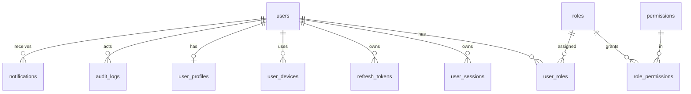
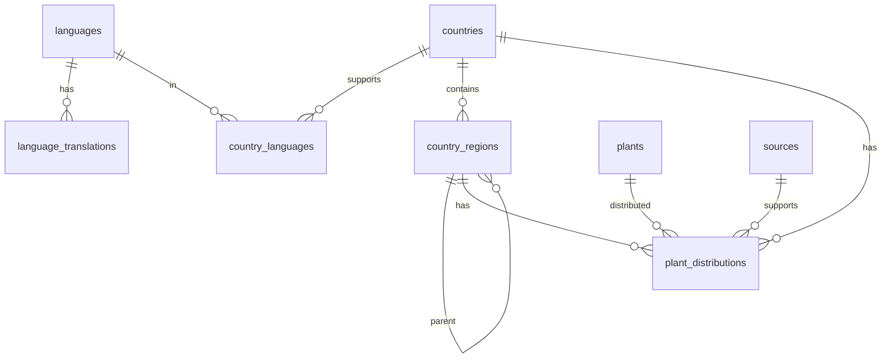
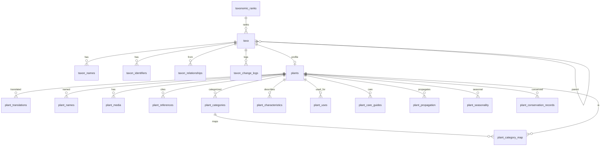
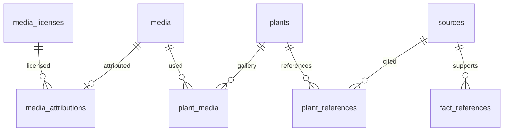
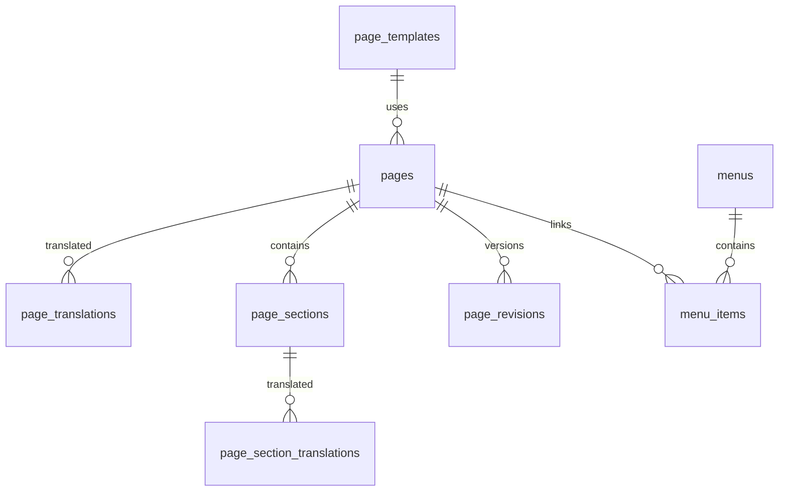
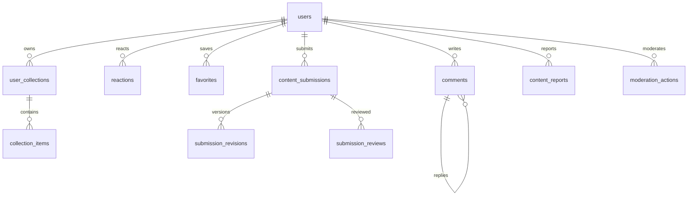
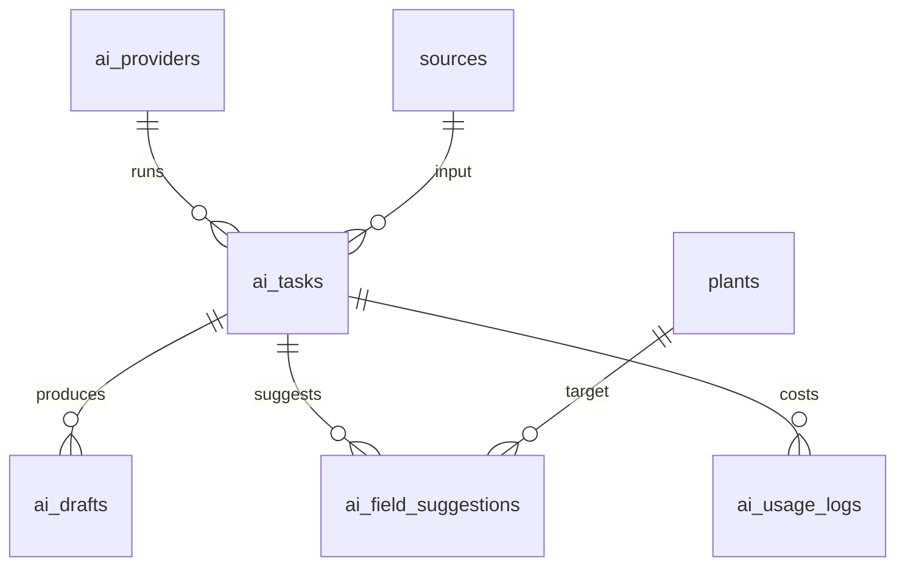

# ERD v1 — Core Data Model

**Version:** 1.0 (Phase 0)
**Date:** 26 November 2026
**Status:** Draft for review
**Scope:** v1 launch entities. Marketplace, payments, reviews, nurseries, observations, and identification are deferred.

---

## 1. Modeling rules

1. `taxa` is the single source of truth for taxonomic identity.
2. `plants` is the editorial profile, 1:1 with a species-level taxon.
3. Country-specific distribution is separate from global taxonomy.
4. Translations live in `*_translations` tables, one row per locale.
5. Evidence is attached at fact level, not only page level.
6. JSON is allowed only for flexible configuration (page sections, provider metadata).
7. Every foreign key is indexed.
8. Deleting a parent is restricted by default; cascade only for owned children.

---

## 2. Identity and access

| Table | Key columns |
|---|---|
| `users` | `id`, `email` (unique), `phone` (unique, nullable), `password_hash`, `status`, `email_verified_at`, `phone_verified_at`, `mfa_secret`, `locale`, timestamps |
| `user_profiles` | `user_id`, `display_name`, `bio`, `avatar_media_id`, `country_id`, `expertise` |
| `roles` | `id`, `code` (unique), `name`, `is_system` |
| `permissions` | `id`, `code` (unique), `group` |
| `role_permissions` | `role_id`, `permission_id` |
| `user_roles` | `user_id`, `role_id`, `country_id` (nullable scope) |
| `user_sessions` | `id`, `user_id`, `device_id`, `ip`, `user_agent`, `last_active_at`, `revoked_at` |
| `refresh_tokens` | `id`, `user_id`, `session_id`, `family_id`, `token_hash`, `expires_at`, `revoked_at`, `replaced_by` |
| `user_devices` | `id`, `user_id`, `name`, `platform`, `push_token` |
| `audit_logs` | `id`, `actor_id`, `action`, `target_type`, `target_id`, `before`, `after`, `ip`, `user_agent`, `created_at` |
| `notifications` | `id`, `user_id`, `type`, `data`, `read_at`, `created_at` |

---

## 3. Localization and geography

| Table | Key columns |
|---|---|
| `languages` | `code` (unique), `name`, `native_name`, `direction`, `is_default`, `is_active` |
| `language_translations` | `locale`, `group`, `key`, `value`; unique `(locale, group, key)` |
| `countries` | `code` (ISO-2, unique), `name`, `default_locale`, `is_active`, `is_default` |
| `country_settings` | `country_id`, `key`, `value` |
| `country_regions` | `id`, `country_id`, `parent_id`, `type` (division/district/upazila), `name`, `code` |
| `country_languages` | `country_id`, `language_code`, `is_default` |
| `plant_distributions` | `id`, `plant_id`, `country_id`, `region_id`, `establishment_means`, `occurrence_status`, `is_sensitive`, `source_id` |

`establishment_means`: `native`, `introduced`, `invasive`, `casual`, `uncertain`, `absent`.
`occurrence_status`: `present`, `probably_present`, `doubtful`, `extinct`.

---

## 4. Taxonomy and plants

| Table | Key columns |
|---|---|
| `taxonomic_ranks` | `id`, `name`, `level`, `is_required` |
| `taxa` | `id`, `parent_id`, `rank_id`, `scientific_name`, `author_citation`, `year`, `nomenclatural_status`, `is_hybrid`, `is_cultivar`, `status`, `slug` |
| `taxon_names` | `id`, `taxon_id`, `name`, `rank_id`, `status` (accepted/basionym/synonym), `author`, `year`, `source_id` |
| `taxon_identifiers` | `id`, `taxon_id`, `provider` (IPNI/POWO/GBIF/WFO), `identifier`; unique `(provider, identifier)` |
| `taxon_relationships` | `id`, `from_taxon_id`, `to_taxon_id`, `type` |
| `taxon_change_logs` | `id`, `taxon_id`, `change_type`, `before`, `after`, `actor_id`, `created_at` |
| `plants` | `id`, `taxon_id` (unique), `slug` (unique), `status`, `verification_status`, `completeness_score`, `published_at` |
| `plant_translations` | `id`, `plant_id`, `locale`, `common_name`, `description`, `habitat`, `uses`, `care_summary`, `seo_title`, `seo_description`; unique `(plant_id, locale)` |
| `plant_names` | `id`, `plant_id`, `locale`, `name`, `type` (common/local/synonym), `region_id`, `source_id` |
| `plant_categories` | `id`, `slug`, `parent_id`, `sort` |
| `plant_category_map` | `plant_id`, `category_id`; primary `(plant_id, category_id)` |
| `plant_characteristics` | `plant_id`, `habit`, `height_min_cm`, `height_max_cm`, `leaf_type`, `leaf_arrangement`, `flower_color`, `flower_shape`, `fruit_type`, `bark_texture`, `root_type` |
| `plant_attributes` | `plant_id`, `key`, `value`, `source_id` (extensible facts) |
| `plant_uses` | `plant_id`, `use_type`, `description`, `source_id` |
| `plant_care_guides` | `plant_id`, `light`, `water`, `soil`, `temperature_min_c`, `temperature_max_c`, `humidity`, `notes` |
| `plant_propagation` | `plant_id`, `method`, `notes` |
| `plant_seasonality` | `plant_id`, `region_id`, `event` (planting/flowering/fruiting), `start_month`, `end_month` |
| `plant_conservation_records` | `plant_id`, `iucn_category`, `national_status`, `source_id`, `assessed_at` |

`verification_status`: `unverified`, `community_reviewed`, `editor_verified`, `expert_verified`.

---

## 5. Media and evidence

| Table | Key columns |
|---|---|
| `media` | `id`, `disk`, `path`, `mime`, `width`, `height`, `size`, `checksum`, `uploaded_by`, `created_at` |
| `media_licenses` | `id`, `code`, `name`, `url`, `requires_attribution` |
| `media_attributions` | `media_id`, `creator`, `source_url`, `license_id`, `attribution_text` |
| `plant_media` | `plant_id`, `media_id`, `type` (whole/leaf/flower/fruit/bark/stem/seed/root/habitat), `is_primary`, `sort` |
| `sources` | `id`, `title`, `publisher`, `url`, `license`, `accessed_at`, `language`, `notes` |
| `plant_references` | `id`, `plant_id`, `source_id`, `citation`, `url` |
| `fact_references` | `id`, `fact_type`, `fact_id`, `source_id`, `note` |

---

## 6. CMS and SEO

| Table | Key columns |
|---|---|
| `pages` | `id`, `slug` (unique), `template_id`, `status`, `published_at`, `created_by` |
| `page_translations` | `page_id`, `locale`, `title`, `seo_title`, `seo_description`; unique `(page_id, locale)` |
| `page_sections` | `id`, `page_id`, `type`, `sort`, `settings` (JSON) |
| `page_section_translations` | `section_id`, `locale`, `settings` (JSON) |
| `page_revisions` | `id`, `page_id`, `snapshot` (JSON), `created_by`, `created_at` |
| `page_templates` | `id`, `code`, `name`, `description` |
| `menus` | `id`, `location`, `locale` |
| `menu_items` | `id`, `menu_id`, `parent_id`, `label`, `url`, `page_id`, `sort` |
| `website_settings` | `key`, `value` |
| `seo_metadata` | `entity_type`, `entity_id`, `locale`, `title`, `description`, `og_media_id`, `canonical`, `robots` |
| `redirects` | `id`, `from_path` (unique), `to_path`, `status_code`, `hits` |

Section types at launch: `hero`, `rich_text`, `plant_grid`, `category_grid`, `article_grid`, `statistics`, `cta`, `faq`.

---

## 7. Community and moderation

| Table | Key columns |
|---|---|
| `comments` | `id`, `user_id`, `commentable_type`, `commentable_id`, `parent_id`, `body`, `status` |
| `reactions` | `id`, `user_id`, `reactable_type`, `reactable_id`, `type`; unique `(user_id, reactable_type, reactable_id)` |
| `favorites` | `user_id`, `plant_id`; primary `(user_id, plant_id)` |
| `user_collections` | `id`, `user_id`, `name`, `is_public` |
| `collection_items` | `collection_id`, `plant_id`, `sort` |
| `content_submissions` | `id`, `user_id`, `type`, `payload` (JSON), `status`, `submitted_at` |
| `submission_revisions` | `id`, `submission_id`, `payload`, `created_by`, `created_at` |
| `submission_reviews` | `id`, `submission_id`, `reviewer_id`, `decision`, `notes`, `created_at` |
| `content_reports` | `id`, `reporter_id`, `reportable_type`, `reportable_id`, `reason`, `status` |
| `moderation_actions` | `id`, `moderator_id`, `target_type`, `target_id`, `action`, `reason`, `created_at` |

---

## 8. AI assist

| Table | Key columns |
|---|---|
| `ai_providers` | `id`, `code`, `name`, `is_active`, `settings` (encrypted JSON) |
| `ai_tasks` | `id`, `provider_id`, `type`, `status`, `input` (JSON), `prompt_version`, `started_at`, `finished_at` |
| `ai_drafts` | `id`, `task_id`, `plant_id`, `locale`, `content`, `status`, `reviewed_by` |
| `ai_field_suggestions` | `id`, `task_id`, `plant_id`, `field`, `current_value`, `proposed_value`, `confidence`, `status` |
| `ai_usage_logs` | `id`, `task_id`, `tokens_in`, `tokens_out`, `cost`, `created_at` |

---

## 9. Indexes and constraints (highlights)

| Table | Index / constraint |
|---|---|
| `plants` | unique `slug`, unique `taxon_id`, index `status` |
| `plant_translations` | unique `(plant_id, locale)`, full-text candidate |
| `plant_names` | index `(name, locale)`, index `plant_id` |
| `taxa` | index `parent_id`, index `rank_id`, index `scientific_name` |
| `taxon_names` | index `name`, index `taxon_id` |
| `plant_distributions` | unique `(plant_id, country_id, region_id)`, index `establishment_means` |
| `comments` | index `(commentable_type, commentable_id, status)` |
| `reactions` | unique `(user_id, reactable_type, reactable_id)` |
| `audit_logs` | index `(target_type, target_id)`, index `actor_id`, index `created_at` |
| `redirects` | unique `from_path` |
| `refresh_tokens` | index `token_hash`, index `family_id` |

---

## 10. Deferred tables

Not created in v1: `nurseries`, `nursery_products`, `products`, `orders`, `payments`, `subscriptions`, `reviews`, `business_reviews`, `plant_observations`, `identification_requests`, `api_clients`, `api_usage_logs`.

Add them with their own migration and ADR when the phase starts.

---

*End of ERD v1.*
